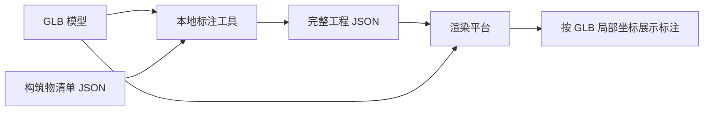

# 项目设计

## 目标

为 GLB/GLTF 三维模型建立一套稳定的点位标注流程。标注结果不仅记录每个构筑物的中心坐标，还记录模型当时的状态信息，方便上传到渲染平台后按同一模型坐标系复现。

## 核心概念

通俗理解：模型是一张三维地图，点位 JSON 是地图上的地址簿。只要渲染平台打开的是同一张地图，地址就能找到；如果地图被重新缩放、旋转或改了原点，地址就需要重新校准。

专业定义：

- GLB：GL Transmission Format Binary，二进制 3D 模型格式。
- 局部坐标：模型自身坐标系里的坐标，不受浏览器为了居中显示而做的相机移动影响。
- 包围盒：Bounding Box，模型在 X/Y/Z 三个方向上的最小和最大边界。
- 锚点：Anchor，业务对象绑定到模型上的一个点，本项目用 `center` 表示。

## 数据流

## 模块边界

- `app/index.html`：纯前端采集工具，负责加载模型、采集点位、导出 JSON。
- `app/data/structures_named.json`：默认标注清单，只保存业务对象和采集状态。
- `app/assets/models/`：模型文件目录。未来多个模型可以按项目或模型版本分目录。
- `docs/`：记录设计、数据格式和操作流程，避免下次接平台时重新猜。

## 后续扩展建议

1. 后端上传接口：保存 GLB 文件、完整工程 JSON、文件 SHA-256 指纹和版本号。
2. 点位校验页：上传后随机抽查若干点位，确认位置没有偏移。
3. 模型版本管理：同一个项目下允许多个模型版本，每个版本有独立点位文件。
4. 结构化标注：除了中心点，可扩展 `bbox`、`polygon`、`meshName`、`tags` 等字段。
